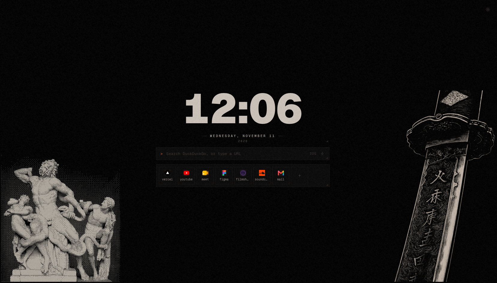
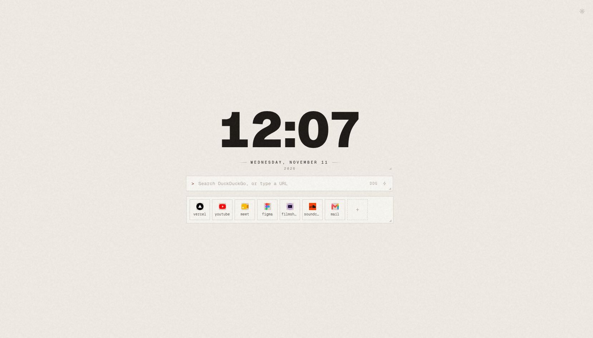
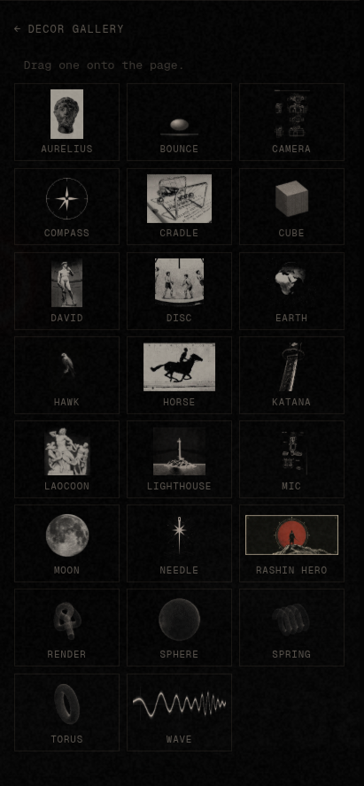

<div align="center">

# ixi-wave extension

**A new-tab page, in one small Chrome extension.**

Replace your browser's new tab with a quiet, warm dashboard — bookmarks, tasks,
timers, a calendar, a clock, shortcuts and live weather — and arrange every panel
however you like.

</div>

<div align="center">
  
  
</div>

<div align="center">

<sub>Ships light and dark · Version 0.10.18 · Manifest V3 · Chromium (Chrome, Edge, Brave, Arc, Opera)</sub>

</div>

---

## What it is

The **new tab** is the main surface — a paper-textured dashboard you arrange
yourself. Every widget is a floating panel you can move, resize, or remove, and
the layout is remembered per browser profile.

The **toolbar popup** is the smaller half: check your installed version against
the published one and install a newer build in a click.

## Features

### New tab page

| Widget | What it does |
| --- | --- |
| **Search bar** | Type to search; a keyword (`gh`, `yt`, `wiki`, …) swaps the engine inline, and `>` runs a command. |
| **Clock** | The date and time, in several faces — from clean Geist to pixel-cut display fonts. |
| **Bookmarks** | Your saved links, as a panel. |
| **Open tasks** | Task lists you can share — connect a list and check items off from the new tab. |
| **Running timers** | Countdowns and stopwatches that survive a refresh. |
| **Calendar** | The month at a glance, today marked. |
| **Shortcuts** | Pinned sites, either as a grid or as a single large icon. |
| **Weather** | Current conditions and a short forecast for your city. |
| **Decor** | Small 3D objects to place around the page — purely for the look of it. |

Everything is **positioned by dragging** and the arrangement is saved. Widgets
can be added more than once where it makes sense — two clock faces, a *Work*
shortcut group and a *Media* one, a task list per project.

**Deep search integration.** Hit `/` or start typing to focus the box. Prefix a
query with a bang to target a site without leaving the page:

```
gh  reactive streams        →  GitHub search
yt  lofi beats              →  YouTube
wiki  tiling window manager →  Wikipedia
pp  how do async iterators work
```

There are 23 bangs built in (GitHub, Stack Overflow, MDN, npm, PyPI, crates.io,
Hugging Face, YouTube, Spotify, Twitch, Reddit, IMDb, Maps, Amazon, and more),
plus 6 selectable search engines: DuckDuckGo, Google, Brave, Bing, Startpage and
Ecosia.

### Decor gallery

For pure atmosphere, open the decor gallery and drag a small 3D object onto the
page — a classical bust, a katana, a lighthouse, a moon, and more. Each one is
just another panel: move it, resize it, or remove it like anything else.

<div align="center">
  
</div>

### Popup

| Panel | What it does |
| --- | --- |
| **Update** | See your installed version against the published one, and install a newer build in a click (when the optional native updater is set up). |
| **Tools** | Quick access to your timer, bookmarks, vault and shared todos. |

## Design

A warm, low-contrast palette over a subtle paper grain, monospace type, and thin
rules. The point is a page that stays out of the way — readable at a glance,
never shouting, and pleasant to leave open in a spare tab. The whole thing is
themeable, and it ships light and dark.

## Install

The extension is not on the Chrome Web Store. You load it as an **unpacked
extension** from the built archive:

1. Download [`ixi-extension.zip`](ixi-extension.zip) from this repo, or get it
   from the latest [release](https://github.com/Amirabbas-RU/ixi-wave-extension/releases/latest).
2. Unzip it anywhere you'll keep it (e.g. `~/ixi-wave-extension`). **Don't
   delete the folder afterwards** — Chrome loads the extension from it directly.
3. Open `chrome://extensions`.
4. Turn on **Developer mode** (top right).
5. Click **Load unpacked** and pick the folder you unzipped.

Open a new tab and the ixi-wave page appears. Click the toolbar icon for the
popup.

> **Updating.** To install a newer version, replace the files in that folder with
> the newer zip's contents, then press the reload ↻ button on the extension's
> card in `chrome://extensions`. The popup's **Update** panel tells you when a
> newer build exists. If you've set up the optional native updater, it can do
> the download-and-reload for you.

### Permissions, and why

| Permission | Why it's needed |
| --- | --- |
| `storage` | Save your layout, widgets and settings locally in the browser. |
| `favicon` | Show site icons for your bookmarks and shortcuts. |
| `nativeMessaging` | Optional — only used for the one-click self-update, and only if you install the separate updater host. Everything else works without it. |
| `management` (optional) | Requested only at the moment you turn the new-tab override on or off, to check the extension's own state. Not required to use the extension. |
| `https://ixiflower.vercel.app/*` | Check for updates against the published build. |
| `http://localhost:3000/*` | Development only, so a local build of the site can be used while testing. |

Nothing is sent anywhere except your own site, `ixiflower.vercel.app`, and only
for the update check.

## Security

This repository publishes **the built, ready-to-install package and nothing
else**. It contains no server code, no database credentials, no API keys and no
environment files — the extension runs entirely in your browser and holds no
secrets of its own.

See [SECURITY.md](SECURITY.md) for how the extension handles your data and how to
report a concern.

## Versioning

Releases use semantic versions. The version you see in `chrome://extensions` is
the one the **Update** panel compares against the published build — if it says
you're on the latest, you are.

| Version | Notes |
| --- | --- |
| `0.10.18` | Current build. |

## License

Released under a source-available license for personal use — see
[LICENSE](LICENSE). You're welcome to install and use it. Please don't
redistribute or republish it as your own without asking first.

---

<div align="center">
<sub>Made by <a href="https://github.com/Amirabbas-RU">Amirabbas Rouintan</a></sub>
</div>
